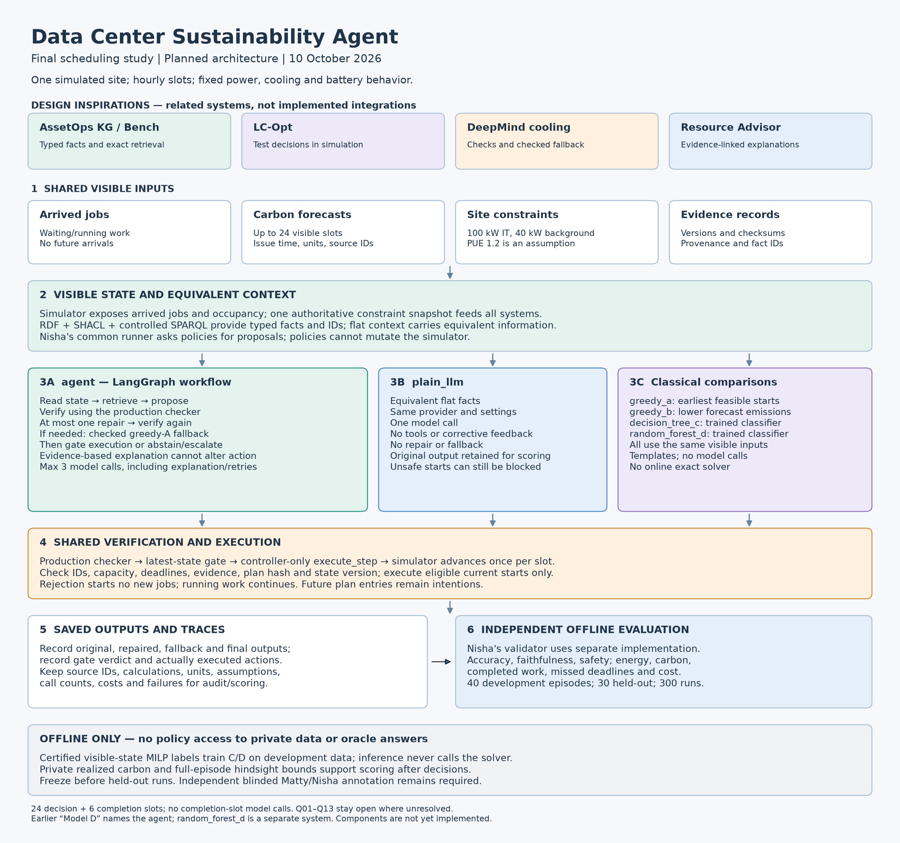

Teammates and roles

- Edison Perez Cash: energy and carbon calculations, greedy scheduling references, and trained decision-tree and random-forest policies (E2).
- Matty Anderson and Nisha Mahadev Kolekar: the LangGraph agent and plain-LLM comparison, verification and safety, evidence-based explanations, integration, evaluation and reporting (E4-E6).
- Reimo Tamme: source data, synthetic jobs, scenario splits and the simulator, working with Ved on E1 and E3.
- Ved Patil: shared contracts, ontology and retrieval, offline reference schedules and reproduction, working with Reimo on E1 and E3.

All teammates contribute their technical sections, interface coordination and results. Matty and Nisha share the research responsibilities listed above; their detailed implementation duties are divided in the [responsibility checklist](docs/team/03_RESPONSIBILITY_CHECKLIST.md). The package's detailed lead allocations remain recorded under Q12.

# Data Center Sustainability Agent

November 25 preparation: [selective continuation support](docs/rule_study/RULE04_SELECTIVE_CONTINUATION_NOV25.md) can authenticate a preserved development-attempt prefix and prepare only its unexecuted suffix. It cannot retry failed pairs or reuse an authorization. The public CLI inspects only; another execution requires new merged pins and fresh exact approval. Current evidence handoff is separate from this offline implementation, and earlier dated entries remain historical records.

November 24 actual attempt: [the approved development attempt failed](docs/rule_study/RULE04_ID_FIX_NOV24.md) on episode-ID schema validation after3.719seconds, with verified cleanup and zero completed case-policy runs. Its ID is consumed. The controller correction is prepared; another attempt requires corrected merged pins and fresh exact authorization. New comparison results remain pending. Earlier same-day pre-run statements below describe their historical state.

November 24 reporting update: [the reviewed summary utility](docs/handoffs/RULE04_SUMMARY_REVIEW_NOV24.md) checks retained artifacts and produces descriptive tables/plots without running policies. Its two new scripts require refreshed source pins and a new request; no study result or run approval is implied.

November 24 follow-up: [review 3 fixes](docs/rule_study/RULE04_REVIEW3_FIXES_NOV24.md) check full nested Windows paths, retain original request provenance and report partial coverage. Earlier requests are superseded; no study ran. Fresh approval must accept potentially unexercised missing-forecast controls under the unchanged limits.

November 24 freeze review: [the protocol record](docs/rule_study/RULE04_FREEZE_REVIEW_NOV24.md) fixes the accepted software/design and retained development inputs/metrics. Final-set isolation remains untested, and no run is authorized. Exact proposed limits and a fresh single-use request still require Matty's approval. Earlier dated pending-freeze notes below are historical where superseded.

November 24 current: Nisha's independent accounting/metric receiving is accepted within its recorded scope: the retained 120-case development pair and ten authored metric illustrations. The original reply and hashes are preserved in [the receiving record](docs/handoffs/RULE04_ACCOUNTING_RECEIVING_NOV24.md). The first demo package is merged through #275. No policy has run on the 120 development cases; final isolation, whole-study freeze, fresh exact run approval, comparative evaluation and reproduction remain pending. Earlier dated pending-receiving statements below are historical where superseded.

November 23 accounting handoff: [Edison supplied the actual partial development pair and first metrics](docs/handoffs/RULE04_DEVELOPMENT_HANDOFF_REVIEW_NOV23.md). Original files are preserved; post-processing was directly corrected outside the frozen scientific package. Independent accounting/metric receiving, whole-study freeze and authorized development/final rollouts remain pending. The 10 authored metric examples are saved-record illustrations, not unseen performance. Earlier missing-file status below is historical where superseded.

November 23 latest: [Nisha's new independent receiving](docs/handoffs/RULE03_NATIVE_INDEPENDENT_RECEIVING_NOV23.md) is accepted within scope. All 202 planned primary/authored case-policy traces are completely replayed across the preserved attempts; checked safety/progress properties pass, with S4 limited to the authored rules-v1 fault case. The exact verification-code baseline is recorded. This completes the bounded verification component, not accounting, unseen evaluation, generalization or the whole-study freeze. Edison's actual files/metrics remain the next handoff. Older dated entries below are historical where superseded.

November 23 latest: the separately authorized [native-host continuation](docs/handoffs/RULE03_NATIVE_CONTINUATION_NOV23.md) completed with scoped PASS in 54.265 seconds: 10 authored runs and 51 retained Greedy B replays, 2,130 new charged steps and 12,130 cumulative. Rules-v1 authored fault coverage S4 now passes; primary S4 remains NOT_RUN. Nisha must receive this new scope independently, and accounting/freeze/final evaluation remain pending. Original INCOMPLETE and intermediate host FAIL records are preserved. No primary regeneration, model call or final-set generation occurred. Earlier dated status below is historical where superseded.

November 23 continuation preparation: [the narrow launcher](docs/rule_study/NARROW_CONTINUATION_PREPARATION_NOV23.md) is implemented and offline-tested for10 authored runs plus51 saved Greedy B replays, without regenerating192 primary traces. Source and evidence pins, original-ID refusal, one shared bound and cumulative counts are enforced. A static dry test verified/extracted all29,569 retained files with zero policy/replay work. The actual scientific continuation remains NOT_RUN pending a freshly reviewed exact request and approval; original INCOMPLETE findings remain unchanged.

November 23 independent receiving: [Nisha confirmed the retained evidence](docs/handoffs/RULE03_INDEPENDENT_RECEIVING_NOV23.md), including all file hashes, source bindings and recorded coverage. Overall remains INCOMPLETE; authored/S4 and the unfinished Greedy B replay are still missing. In all12 jointly infeasible primary cases, all three policies start no jobs; safe refusal does not salvage a feasible subset. No policy was changed or further scientific run/replay performed.

November 22 actual bounded verification: the approved attempt ran once on merged code `3daf00f7` and stopped at its 10,000-state ceiling after 107.172 seconds. All 192 primary case-policy traces were generated. Replay completed for all 64 rules-v1 and 64 Greedy A traces, but only 13 Greedy B traces; 51 Greedy B traces remain incomplete and none of the 10 authored case-policy runs happened. Overall status is INCOMPLETE, not a scientific freeze or generalization result.

The completed primary rules-v1 and Greedy A replay has scoped safety/progress passes; invalid-proposal S4 is NOT_RUN because that primary domain contains no invalid proposal. [The actual report, retained evidence and limitations](docs/handoffs/RULE03_BOUNDED_ATTEMPT_NOV22.md) record exactly what was checked. The consumed authorization is not retried. A [narrow continuation proposal](docs/evidence/rule03-nov22/continuation-proposal.json) identifies the remaining saved Greedy B replay and authored cases; fresh exact authorization is required before any further scientific execution/replay. Edison still supplies actual accounting/metric files for separate receiving and final evaluation. No model call, restricted source/private input or final unseen case was used.

Original team-written code is licensed under [Apache-2.0](LICENSE), with the [scope and exclusions](LICENSE_SCOPE.md) and [third-party notices](THIRD_PARTY_NOTICES.md) retained. Contributor replies are received; final assembled-package acceptance remains part of #244. [Current handoffs](docs/handoffs/NOV22_RECEIVING_LICENSE_AND_STATUS.md) identify the next work without repeating completed agreement requests.

November 19 active plan: [the focused rule-system study](docs/decisions/NOV19_RULE_STUDY_PLAN.md) supersedes the November 18 evidence-only baseline as our primary delivery. Missing source permissions/provenance/verified inputs prevented the original held-out study; Professor Hasan recommended lifting explicit rules from representative permitted examples, lowering them into an executable discrete scheduler and independently verifying safety and progress. We will demonstrate two scenarios and, after frozen-protocol authorization, test on new independently authored synthetic cases against compatible Greedy A/B references. Core work is due November 25, fixes/reproduction November 26-27 and audited candidate November 28. Start now; these are deadlines, not start dates. The evidence-only package remains backup. The original research question is unanswered; no new results, source approval or model runs are claimed. Earlier dated status entries below are historical where superseded.

November 20 implementation receiving: Nisha’s independent verifier harness is merged through PR #250; this is not verification of the actual rule scheduler. Ved has accepted the adapter contract, while his executable handoff remains pending. Edison’s response is now received as recorded below. Matty’s [offline timeout rehearsal](docs/rule_study/OFFLINE_SUPERVISOR_PREPARATION.md) tests dummy processes only. Actual study dispatch, authenticated evidence and final results remain pending.

November 20 generator receiving: Edison’s exact review-2 response is received. The development-only synthetic generator is implemented and fixture-tested against the independent case checker. Final generation remains disabled pending the frozen-code single-use dispatcher and exact authorization; metrics/accounting and actual policy verification remain pending. See [generator receiving](docs/rule_study/RULE04_GENERATOR_RECEIVING.md).

November 18 active delivery: [Matty explicitly activated development-evidence-only delivery](docs/decisions/NOV18_EVIDENCE_ONLY_ACTIVATION.md). Finish the report and saved-evidence demo from existing permitted public/sanitized records without waiting for Reimo or new source processing. The planned held-out study remains unexecuted and the research question unanswered. Source B1-B3 remain unresolved, B4 provisional; no new data/model/solver/training operation is authorized. This supersedes earlier inactive-contingency/November 22 wait statements for the active delivery scope; historical records remain preserved.


The new focused question is: Can a small set of explicit rules reproduce safe, explainable scheduling decisions and generalize to unseen synthetic scenarios? We will use a normal carbon-aware scheduling case and an overloaded/infeasible fallback case. The new work is planned, not completed. It will use new artificial inputs with declared provenance, not the source-dependent private corpus. Safety/progress claims will be restricted to the independently verified bounds and assumptions. The old Agent-versus-Plain study is not replaced by an invented positive result.

Active task handoffs: [Matty specification #239](https://github.com/ReymoT/data-center-agentic/issues/239) -> [Ved implementation #240](https://github.com/ReymoT/data-center-agentic/issues/240) -> [Nisha independent verification #241](https://github.com/ReymoT/data-center-agentic/issues/241) -> [Edison synthetic comparison #242](https://github.com/ReymoT/data-center-agentic/issues/242) -> [Matty final audit #244](https://github.com/ReymoT/data-center-agentic/issues/244). [Reimo report/methods #243](https://github.com/ReymoT/data-center-agentic/issues/243) proceeds in parallel. Preparation starts now; details and dates are in the approved plan.

The [development bundle assembler](docs/handoffs/DEVELOPMENT_BUNDLE_PREPARATION_NOV15.md)
now prepares the missing input format from explicit episode JSONs and a permitted
row extract. Synthetic checks pass; no real bundle preparation, source permission
or study result is claimed. The evidence-only delivery path is now activated; this does not authorize the assembler.

November 13 controls: [all affected scope replies are received; offline state-export controls are implemented and synthetic-tested](docs/handoffs/NOV13_STATE_EXPORT_CONTROLS.md). Real state export/source use remains unauthorized. Matty confirmed his rating availability; the contingency remains unactivated and I02 unfrozen.

November 13 planning: [Matty accepts Nisha's safeguards and future scoped state receiving offer](docs/decisions/NOV13_SAFEGUARDS_AND_FEASIBILITY.md). The conservative internal freeze/feasibility checkpoint is November 22 at 6 PM Arizona, reserving reproduction, I04 and repair time before December 7. These are planning targets, not completed work or execution permission; the contingency remains unactivated.

November 12 planning update: [the manager ingest requirements and scientific contingency proposal](docs/decisions/NOV12_INGEST_REQUIREMENTS_AND_CONTINGENCY.md) confirm that metadata receiving does not authorize source access. The [missing-state recovery/generation plan](docs/handoffs/CF60_DEVELOPMENT_STATE_PLAN_2026-11-12.md) separates original-state recovery from new evidence. No reduced study, private input access, state generation or run is approved.

November 12 receiving update: [Reimo accepted revision 2 and Nisha reports metadata-only private receiving PASS](docs/handoffs/NOV12_CUSTODY_RECEIVING_AND_PENDING_INGEST.md). Matty received the authenticated public handoff with explicit evidence limits. The pending ingest checklist is refreshed; source-use evidence, operational ingest approval, actual episode contents, compatibility and scientific freeze remain outstanding. No selection rerun, source read or model call is authorized.

November 11 follow-up: [the source questions are sent and offline installed-artifact identities match](docs/handoffs/NOV11_SOURCE_REQUESTS_AND_OFFLINE_IDENTITY.md). Nisha reports the restricted v2 record delivered to Reimo; his exact acceptance is next. Actual custody receiving, source acceptance and scientific freeze remain pending. No source data or model request was used.

November 11 status: [the manager handoff and offline configuration bindings](docs/handoffs/NOV11_MANAGER_READINESS_AND_HANDOFF.md) are prepared. Reimo has responded and his draft reviews are published in PR #208. Issue #60 is reopened: access to the exact restricted v2 record, authenticated approval and authoritative source evidence remain outstanding. No private selection, source ingest or study run is complete. The I02 checklist remains unfrozen.

November 10 protocol decision: [the agreed prospective response profile is adopted and v2 forecast scope is legacy or CF60 only](docs/decisions/NOV10_PROFILE_ADOPTION_AND_FORECAST_SCOPE.md). Runtime defaults and prior evidence remain unchanged. Reimo's v2 parameter confirmation, actual selection/receiving, source-use evidence, compatibility and full I02 freeze still gate execution.


November 10 offline readiness: [the versioned selector, saved-content assessment and future trace binding](docs/handoffs/NOV10_SELECTOR_CONTENT_AND_TRACE.md) preserve the fixed development allocation and old evidence. Nisha's #60 read-footprint/order reply is received; real selection/custody, source permission and freeze remain pending. The content assessment flags unsupported claims; no shared-default promotion or research superiority is claimed.


Latest November 9: [the corrected claim-pairing candidate passed public technical validation](docs/handoffs/A01_PAIRED_CLAIM_VALIDATION_RESULT_2026-11-09.md).
RUN-cb85f5a3425c completed six systems and 180 decision records with 17 requests in
532.219 seconds; all native/offline token counts matched, replay had zero findings
or result mismatches, and cleanup passed. All 39 generated claims paired numeric
values with units. Agent completed J1 through fallback and J2 from an initial model
plan; both repairs failed their checks. [Nisha's separate-person technical receiving
is accepted](docs/handoffs/A01_CB85_NISHA_RECEIVING_2026-11-10.md) on November 10 after the ZIP hash was confirmed. Explanation
faithfulness, source/CF60 acceptance and scientific freeze remain pending. This is
not a held-out result or shared-default adoption. The single-use ID is consumed.


Earlier November 9: [the authorized explanation-settings validation stopped safely](docs/handoffs/A01_EXPLANATION_VALIDATION_OUTCOME_2026-11-09.md)
at Agent slot 2 on an explanation whose three claim units lacked numeric values.
RUN-bc420d3e8d72 used 12 requests; failure was recorded at 386.453 seconds. All 12 native/offline
prompt counts matched. Five complete systems replay with zero findings/mismatches;
Agent remains partial (152 saved decision records total). Cleanup passed, no retry
occurred and the single-use authorization is consumed. This is not candidate
adoption, a six-system pass or a held-out study result.


Earlier: [the authorized action-choice validation passed](docs/handoffs/I01_ACTION_CHOICE_VALIDATION_RESULT.md)
for RUN-fd87c6c8a9cb: six systems, 180 traces, 17 requests, 445.156 seconds,
zero replay findings/result mismatches and successful cleanup. Agent completed
J1/J2 using one model-initial start and one fallback start; Plain completed no
jobs. Both Agent repairs failed their checks. Nisha recorded a scoped receiving PASS;
this is public development evidence, not a study result or scientific freeze.

November 4: [the authorized unified public validation passed](docs/handoffs/I01_UNIFIED_VALIDATION_2026-11-04.md).
All six systems completed EP-HAND1: 180 traces, 17 model requests and 326.125 seconds,
with zero replay findings/result mismatches and successful cleanup. Nisha's scoped
[evidence receiving PASS is accepted](docs/handoffs/I01_NISHA_UNIFIED_RECEIVING_2026-11-04.md).
The later authorized action-field validation RUN-15e69e6129b7
[stopped on an invalid Agent response](docs/handoffs/I01_ACTION_FIELDS_VALIDATION_OUTCOME.md):
10 requests, five complete results and one partial Agent trace. All nine raw plans
contained explicit nonempty actions, but one both started and abstained from J2.
Cleanup passed; no retry occurred. Complete I01 and prompt/schema freeze remain
blocked. The linked offline audit distinguishes model actions from fallback; no
study improvement is claimed.
This is integration evidence, not a held-out study or final acceptance. The
[CF60 compatibility plan](docs/handoffs/CF60_DEVELOPMENT_COMPATIBILITY_PLAN.md)
prepares development comparisons without changing forecasts, labels or models.

Earlier November 4: [Nisha's independent development content receiving is accepted](docs/handoffs/I01_NISHA_RECEIVING_ACCEPTANCE_2026-11-04.md).
All six original units and 180 traces passed her scoped replay review, with the
supplied report preserved unchanged and manager corroboration recorded. The
private transfer/content-receiving dependency is resolved. Full I01, source and
forecast acceptance and scientific freeze remain open. The later authorized public
validation below does not authorize further requests.

[Recomputed development-fold classification metrics](models/DEVELOPMENT_FOLD_METRICS.md)
now cover all five C/D grid configurations and three fixed folds. These are
descriptive development scores; frozen models and rollout-based selection are
unchanged. [The manager follow-up](docs/handoffs/NOV02_MANAGER_FOLLOWUP.md)
records receiving/custody limits and the remaining official-information gaps.

The [read-only trace explorer](docs/report/UI_VISUALIZATION.md) now presents saved
public-development stages and execution with filters and original file hashes.
It makes no model calls. [Unified receiving readiness](docs/handoffs/I01_UNIFIED_READINESS_AND_EXPLORER.md)
records the historical candidate preparation and offline pin checks. The later
validation receipt below records the actual authorized execution.

The [November 4 latency/readiness refresh](docs/handoffs/NOV04_LATENCY_LABELS_AND_READINESS.md)
records the passed no-startup dry run and original pending authorization template.
Matty later approved that exact single-use run; the template remains unchanged.
The forecast-tie diagnostic and [E06 table integration](docs/handoffs/E06_STUDY_TABLES.md)
are implemented offline. Final analysis acceptance and measured held-out study
rates remain pending.

Future Agent traces now retain summed request latency consistently with Plain;
historical missing values stay missing. The read-only legacy-label audit confirms
flat forecasts and selected-schedule labels, without claiming an exact count of
alternate global optima or changing the original models.

Current development status, November 2: all 40 development episodes are
materialized. Real C/D models are trained and reloaded; A/B/C/D completed public
EP-HAND1 receiving. Plain and Agent completed the same public bundle in an earlier
authorized run. Independent replay has zero findings/result mismatches in those
receiving records. These separate runs are not one frozen six-system experiment.
I01 is partial; source acceptance, actual held-out custody/freeze, full experiments
and final I04 acceptance remain open. Calibration #22 is closed; originals and
the approved prospective clarifications are retained. Held-out reliability #95
and official course requirements #16 remain open.

See the [current acceptance audit](docs/handoffs/I01_ACCEPTANCE_AUDIT_2026-11-02.md),
[real artifact handoff](docs/handoffs/P04_REAL_DEVELOPMENT_ARTIFACTS.md) and
[source audit](docs/handoffs/SOURCE_ACCEPTANCE_AUDIT.md).

FSE 598, Arizona State University.

The following course attribution and older implementation paragraphs retain their
historical context. Current implementation status is the receiving summary above
and its linked handoff; #112 is closed, C/D runner support and P04 code are merged,
and the complete public-fixture Plain/Agent episodes passed replay.

Nisha's [November 2 course report](docs/decisions/Q13_COURSE_UPDATE_2026-11-02.md)
places Group 15's presentation on November 16, with 15 minutes plus Q&A, and
requires email submission at least two days earlier and one Canvas upload.
Internal targets are deck review November 9–11, rehearsal by November 13 and
submission by November 14. The December 2 demo permits live, recorded or screenshot
delivery. The newer [official report update](docs/decisions/Q13_OFFICIAL_REPORT_2026-11-02.md)
requires 5–10 IEEE conference pages and one PDF, superseding the earlier 15–20-page
plan. Nisha's [November 4 confirmation](https://github.com/ReymoT/data-center-agentic/issues/16#issuecomment-6639775165)
reports project number 21 and December 9 at 11:59 pm. Her [November 20 update](docs/decisions/Q13_NOV20_COURSE_AND_LICENSE_RECEIVING.md) confirms Arizona time and the public-repository requirement. The team license choice and release checks remain pending. December 7 remains the internal report submission target.
These are attributed course reports, not direct assistant access to Canvas.

The [offline I01 preparation](docs/handoffs/I01_OFFLINE_CONFIGURATION_2026-11-02.md)
now includes a six-system candidate configuration and the existing result/trace
hash index. It authorizes no model calls and is not a scientific freeze.

Our research question: Does an ontology-grounded, tool-verified agent improve the accuracy, faithfulness and safety of data-center sustainability recommendations compared with a plain LLM?

For human faithfulness annotations, two reviewers first retain independent original ratings. Nisha is the sole accountable owner for the inter-rater reliability report requested by the professor. Before adjudication, the report must show the matched assertion count, label counts or confusion matrix, raw percent agreement and Cohen's kappa, including a plain-language explanation when label imbalance makes kappa low or undefined. Extraction agreement, adjudicated scores and excluded no-ops/unmatched assertions are reported separately. [The recorded requirement](docs/decisions/PROFESSOR_FEEDBACK_IRR.md) does not permit either original to be rewritten.

We test this question through workload scheduling at one simulated data center. The main comparison is `agent` versus `plain_llm`, using equivalent visible information. The four additional scheduling policies provide reference results. Scheduling is the experimental setting; conclusions will be limited to the evaluated scenarios.

The implementation includes the shared contracts, simulator, impact calculations,
retrieval, six policy paths, verification/controller, runner, training and evaluation
tooling. Current acceptance and limitations are in the audit above; implemented
components and passing development receiving do not establish final study results.

Current workflow update, October 24: [Matty's announcement](https://github.com/ReymoT/data-center-agentic/issues/57) and the coder-owned rule introduced in [instruction 1.27](docs/decisions/Q11_CODER_OWNED_DECISIONS.md) make the coder responsible for internal implementation choices. Shared changes need only directly affected owners; unresolved shared questions escalate within 24 elapsed hours. Ready coding continues while disputed behavior waits. The rule remains in force under instruction 1.28; the implementation/research status and existing scientific gates are unchanged.

[The current-plan audit](docs/handoffs/CODER_PLAN_AUDIT_2026-10-24.md) corrects stale pending-input/readiness text and links the separate P02, source and scoring issues. The coder-owned decision rule first published in 1.25 remains unchanged in 1.27. Reimo delivered the source inventory early through PR #65; final source/scientific acceptance is still open.

Latest October 28 evaluation update: PR #104 retains Nisha's development matching and inter-rater report over unchanged originals. The 32 matched claims have 75% raw label agreement and Cohen's kappa 0.00; the report explains the single-label prevalence limitation. The 77 listed adjudication items and the later held-out reliability report remain unfinished. This is development protocol evidence, not final faithfulness scoring or a study result.

A01 update, October 30: Nisha and Ved accepted 150 seconds per request and 330 seconds for the pair. After a fresh exact-run authorization, Plain and one Agent Plan request both returned HTTP 200, stopped normally, parsed strictly and matched offline/native prompt counts on full 37/37 Arc/Vulkan offload. Exactly two calls were made with no retry or warm-up, and cleanup passed. This is a public-development transport validation, not a study result or complete Agent episode. [Validation and limits](docs/handoffs/A01_BOUNDED_PAIRED_VALIDATION_2026-10-30.md).

## Systems we reviewed and why we chose this architecture

We reviewed AssetOps Knowledge Graph and AssetOpsBench, LC-Opt, Google DeepMind's data-center cooling system, and Schneider Electric's Resource Advisor Copilot. Our supplied system review compared their data, asset relationships, division of work between an LLM and deterministic software, testing, uncertainty, safety and approval controls.

AssetOps is similar to our project because it connects facts and dependencies through a typed knowledge graph. We use that idea for jobs, slots, constraints and evidence IDs. LC-Opt is similar because it tests decisions in simulation; our final scope uses a small Python scheduling simulator rather than its cooling digital twin. DeepMind is similar because checks and fallback protect execution; we use deterministic schedule checks, a latest-state recheck, checked fallback and abstention. Resource Advisor is similar because it explains sustainability information; we require source-linked claims, units, assumptions and limitations.

We chose a combination of these ideas because our question requires connected evidence, exact calculations, bounded model decisions and comparable saved outputs. RDF represents domain facts. LangGraph manages the agent's sequence of steps. Python checks decide whether a simulated action can execute. This is our best-fit design rationale, not proof that it is the best architecture or will outperform the alternatives. The experiments will test the complete agent; they cannot isolate the ontology's contribution. We have not reproduced these external systems or compared their accuracy directly.

The [source review record](docs/SOURCE_REVIEW.md) identifies the supplied documents and their public references. The [updated architecture diagram](architecture/architecture.svg) and [plain-language architecture document](docs/ARCHITECTURE.md) describe the final scheduling study. The diagram shows the target design; its status note identifies implemented components and remaining acceptance limits.



## Main comparison and scheduling references

The main research comparison uses two systems with the same arrived jobs, visible forecasts and authoritative constraints:

- `agent`: the ontology-grounded LangGraph agent, with one repair and checked greedy-A fallback.
- `plain_llm`: one model call with equivalent flat facts; no tools, repair or fallback.

Four additional policies use the same visible inputs to put scheduling performance in context:

- `greedy_a`: start jobs as soon as feasible.
- `greedy_b`: choose feasible starts with the lowest forecast emissions.
- `decision_tree_c`: a trained scheduling classifier.
- `random_forest_d`: a trained scheduling classifier.

These six systems do not represent six separate research questions. The study evaluates the complete agent against the plain LLM; it does not separately prove the benefit of ontology grounding or tool verification alone.

The earlier name "Model D" means the agent. Policy `random_forest_d` is a different system. Both learned policies are required; greedy policies and offline optimization are not substitutes for classical ML.

The site has 100 kW IT capacity including 40 kW background, constant job power of 10-40 kW and durations of 1-4 hourly slots. Jobs cannot pause once started. PUE 1.2 is a design assumption, with 1.0 used in hand checks. Episodes have 24 decision slots and six completion slots. No model calls occur in completion slots. The recorded Q01 direction permits new starts only in slots0-23; remaining boundary/consumer acceptance is still open.

Energy equals PUE times IT kW times hours. Emissions equal kWh times carbon g/kWh divided by 1,000, with the source's CO2 versus CO2e meaning still to be verified. Timing changes emissions, not the energy required for the same completed fixed-power work. Results must also show completed work, deadline misses and unfinished jobs.

Live equipment control, cooling or water savings, reinforcement learning, Modelica/FMU and enterprise integrations are outside the required project. No LLM fine-tuning is planned.

## Start with the instructions

Read [PROJECT_MASTER.md](PROJECT_MASTER.md), [shared rules](docs/team/01_SHARED_RULES.md), your `MASTER_<NAME>.md` in [the complete package](docs/team/00_START_HERE.md), [interfaces](docs/INTERFACES.md), [open decisions](docs/team/04_OPEN_DECISIONS.md), your assigned Issue and upstream handoffs. Ved's contract 1.0.0 schemas and examples are implemented. The interface document distinguishes those records from planned callable APIs; each consumer must still validate adoption. Experiment CLI names are not runnable commands yet.

See [the current maintenance handoff](docs/handoffs/F03_F04_F05_MAINTENANCE.md) for checks and remaining inputs, and [the publication audit](docs/team/REVIEW_RECORD.md) for current documentation status. The [original setup handoff](docs/handoffs/F01.md) is historical. These documents are published under the project manager's instruction; formal document review is not required.

## Quick start for the repository foundation

The package proposes Python 3.12. Windows is the only supplied dependency-lock target; additional supported operating systems await Q13.

```powershell
git clone https://github.com/ReymoT/data-center-agentic.git
cd data-center-agentic
git switch main
py -3.12 -m venv .venv
.venv\Scripts\python.exe scripts/validate_setup.py
```

The setup validator needs only the Python standard library and makes no network or model calls. It validates documentation links, task ownership/dependencies, role consistency, configuration placeholders and dependency input locations.

To validate the proposed full Windows environment:

```powershell
.venv\Scripts\python.exe -m pip install --require-hashes -r requirements/requirements-windows-py312.lock.txt
.venv\Scripts\python.exe -m pip check
.venv\Scripts\python.exe scripts/smoke_dependencies.py
.venv\Scripts\python.exe -m pytest tests -q
.venv\Scripts\python.exe -m ruff check dc_sustainability scripts tests
.venv\Scripts\python.exe -m ruff format --check dc_sustainability scripts tests
.venv\Scripts\python.exe -m compileall -q dc_sustainability scripts tests
```

Installation needs package-index access. Smoke checks run imports, SHACL/SPARQL, a tiny MILP, classifier fit/save/load and a LangGraph route without an LLM. See [environment instructions](requirements/README.md) for status and troubleshooting. The supplied lock is a candidate, not a final provider-inclusive environment. Do not use its Windows wheel hashes on other platforms.

The offline test command runs F02 contracts, D01/D06 inspection, D02 calibration tooling, D03 provisional scenarios, S01 transitions, L01 preparation, provider helpers, actual Ollama transport against a local synthetic HTTP test server, and actual fixed schedule checks. [New A03 consumer tests](tests/verification/test_d03_consumer.py) exercise D03-generated development jobs against those fixed checks without issuing approvals. Synthetic fixtures and server responses are test-only; they do not establish model inference, source acceptance or end-to-end integration. CI runs the same whole test directory on PRs and main. [The A01/A03 handoff](docs/handoffs/A01_A03_AGREED_CORE.md) links implementation and verification evidence.

All provider/account/settings placeholders in `.env.example` are blank. Keep them blank until the complete Q09 deployment configuration is recorded; the accepted development direction below does not fill missing pins. [The configuration template](configs/project.example.json) records known proposal constants and keeps decision entries null. It is not a production loader or an execution permission.

Matty accepted local Ollama with Qwen3 8B and temperature 0.2. [The Q09 decision](docs/decisions/Q09_OLLAMA_QWEN3.md) records the accepted development settings and owners: Matty prepares the shared adapter/environment, Nisha prepares plain/explanations, and Ved supports F02 compatibility. Matty supplied his [Intel Arc 140V / 32 GB hardware details](docs/HARDWARE.md); Qwen3 8B Q4_K_M is installed with [verified digest/license and reproducible setup](docs/OLLAMA_SETUP.md). The [October 20 Q09 record](docs/decisions/Q09_DEPLOYMENT_OCT20.md) accepts runtime 0.40.5, the full model digest, seeds 101/102/103, output projections and bounded probe rules. One accepted-runtime CPU request later timed out. Nisha and Ved now accept the metadata-only Arc/Vulkan host setting for both systems, subject to before/after identity checks and actual effective-setting/offload evidence. Validated counts/context/resources and a fresh explicit bounded run authorization still block another call.

## Installed local model

Qwen3 8B Q4_K_M is installed outside Git. The [latest desktop metadata](docs/evidence/ollama-qwen3-8b-2026-10-25.json) observes Ollama 0.40.11; accepted runtime 0.40.5 remains pinned. A separate [metadata-only accepted-runtime host check](docs/evidence/a01-igpu-host-2026-10-25.json) detects the Arc 140V through Vulkan with integrated-GPU use enabled. It loaded no model and sent no request, so it is host-discovery evidence rather than successful inference or measured offload.

```powershell
.venv\Scripts\python.exe scripts/inspect_ollama.py --compare docs/evidence/ollama-qwen3-8b-2026-10-25.json
```

## Available adapter and checker core

[The shared Ollama transport](dc_sustainability/llm/provider.py) performs real HTTP, strict F02 parsing, pin checks, deadlines and attempt accounting. It uses the Python standard library without choosing an SDK. Both LLM callers must share one run ledger. Q09 records development output projections, pins and limits; native counter equivalence and a successful matched run are still required. The Arc/Vulkan candidate is not a runnable experiment configuration or automatic model installation.

[The A01 accounting fix](docs/handoffs/A01_ERROR_ACCOUNTING_AND_FOLLOWUPS.md) retains excessively nested JSON failures as spent attempts, including their raw responses. These errors cannot escape the run ledger or allow a new slot to bypass its call cap. The same handoff links the earlier Q10-Q13 proposals; use the October 20 decision records for their current partial agreements and remaining gates.

[The production checker](dc_sustainability/verification/checker.py) now checks exact waiting-job coverage, valid deferral, individual abstention, Q01 start limits, evidence, timing and authoritative capacity. Complete valid plans can physically pass. Carbon claims, reference certification and execution remain separate. [The real controller and trace store](docs/handoffs/A04_CONTROLLER_TRACES.md) recheck current state before execution and preserve duplicate/refusal evidence. [The bounded agent](docs/handoffs/A02_BOUNDED_AGENT.md) uses these real components with explicit reviewed prompt/P02 inputs; missing inputs stay unavailable.

Run these components' offline tests with:

```powershell
.venv\Scripts\python.exe -m pytest tests/llm/test_ollama_provider.py tests/verification/test_checker.py -q
```

## Available plain-LLM preparation and simulator

Nisha's [plain comparator](dc_sustainability/llm/plain.py) and Matty's strict context-boundary fix are merged through PR #14. For a required nonempty-queue decision it uses one shared-adapter request, keeps the original response and performs no repair or fallback. [PR #30](https://github.com/ReymoT/data-center-agentic/pull/30) adds a deterministic empty-queue proposal with zero provider requests/attempts and no explanation. It leaves execution and clock progression to the actual controller through the receiving runner. Full runner adoption remains pending. The [assessment](docs/handoffs/L01_MATTY_ASSESSMENT.md) is historical candidate evidence; the fix is now on main. Full L01 still needs agreed context/deployment inputs and an actual development episode.

Reimo's [S01 simulator](dc_sustainability/simulator/core.py) reveals arrived jobs, applies typed current actions, records occupancy/completions/misses and advances on rejection. Agreed Q01 forbids new starts after 23. [PR #64](https://github.com/ReymoT/data-center-agentic/pull/64) is merged and implements removal of `allow_completion_starts=True` plus the agreed one-decision impossible-arrival visibility. Nisha's independent replay now uses the explicit Option B protocol. Ved's independent reproduction remains pending; merged code and green CI do not replace that scientific evidence. [Receiving tests](tests/verification/test_s01_checker_intake.py) exercise the actual checker/state boundary without bypassing the controller.

```powershell
.venv\Scripts\python.exe -m pytest tests/llm/test_plain.py tests/llm/test_plain_context_boundary.py tests/verification/test_s01_checker_intake.py -q
```

[The October 20 handoff](docs/handoffs/OCT20_SIX_PRIORITIES.md) records the latest agreements, follow-ups and nine A03/E01 hand cases. Nisha's E01 preparation is available through [PR #23](https://github.com/ReymoT/data-center-agentic/pull/23), with [Matty's review and boundary fixes](docs/handoffs/E01_MERGE_REVIEW.md). It independently checks one supplied decision and numerical claims. Structural episode replay is now merged through [PR #28](https://github.com/ReymoT/data-center-agentic/pull/28), with input/metadata comparison fixes and explicit unsupported completed-work handling. Full protocol/reference mapping and actual saved-output evaluation remain open in issue #24. The previously reported capacity-slack discrepancy is fixed; historical f5a2542 evidence remains unchanged. [Offline probe preparation](scripts/prepare_q09_probe.py) renders public development inputs and reports blocked gates; it never calls a model. The October 18 handoff is historical. Configuration examples remain blank.

## Data, experiments and outputs

Reimo implemented pinned SustainDC Arizona source acquisition, checksum/CSV inspection and private UTC observations. Ved's D06 checker/handoff is now merged. [Matty's version-matched Windows verification](docs/handoffs/D06_F04_F05_VERIFICATION.md) reproduced the pinned checksums, 8,760 valid timestamps and a 24-hour UTC window with identical adapter values. This is structural evidence; pollutant meaning, physical interval mapping, dataset rights, factor alignment and F02 adoption still block accepted experimental use. [Data instructions](data/README.md) record acquisition and evidence. D02 implements explicit-field/unit calibration tooling, but actual Frontier access and empirical statistics are still blocked. D03 implements provisional synthetic jobs across four scenarios and private episode assembly; it is not Frontier-calibrated or the frozen development/held-out dataset. Q05/Q06 and downstream adoption remain open. EPA eGRID is an annual plausibility check. Perfect-foresight forecast replay must be labeled and must not be confused with a live forecast.

The implemented source-inspection command is:

```powershell
.venv\Scripts\python.exe -m dc_sustainability.data.carbon_source --help
```

Its help describes local inspection and the optional pinned download. A download uses the network and requires new destination/report files. Validation success is not scientific acceptance; returned records are not adopted F02 forecasts. Offline CI does not download the source.

Use [D02 calibration instructions](data/D02_CALIBRATION.md) for its implemented Python API and source blockers, and [D03 instructions](data/D03_SYNTHETIC_SCENARIOS.md) for the provisional generator. The following implemented command writes a new synthetic development job catalog; use a new filename if it already exists. This test seed is not an accepted experiment seed.

```powershell
New-Item -ItemType Directory -Force data/private | Out-Null
.venv\Scripts\python.exe -m dc_sustainability.data.scenarios data/private/d03-local-jobs.json --seed 42 --split development
.venv\Scripts\python.exe -m pytest tests/verification/test_d03_consumer.py -q
```

The local catalog is ignored by Git. It contains private job metadata and future arrivals: do not pass it wholesale to a policy. Windows CRLF and Git's LF bytes produce different file hashes despite matching JSON content; [the current handoff](docs/handoffs/A03_D03_F04_F05.md) records the observed hashes. The A03 test-only arrived-job projection is separate from the now-implemented S01 simulator; it does not establish full integration.

The proposal requires 40 development episodes and 30 held-out episodes: six dates across four scenarios plus six missing-forecast episodes. Three trials for each LLM and one for each A/B/C/D policy produce 300 runs. Held-out data cannot tune models, prompts or thresholds. The agent has at most three model calls per decision including explanation; the plain LLM has one. Paid runs await Q09.

Nisha will define the CLI during F02/E02 implementation with the module owners. Data validation, graph validation, labels, training, single-episode runs, matrix runs, scoring and figures are planned commands, not runnable commands in this scaffold. The [demo runbook](docs/DEMO.md) records the future evidence requirements without inventing a transcript.

`data/` will hold permitted fixtures and manifests, `ontology/` graph definitions, `models/` trained-artifact manifests, and `results/` trace/evaluation manifests. Raw/private data, generated runs, secrets and large artifacts are excluded from Git by default. License and retention decisions await Q05/Q13. No license is selected here.

## Workflow and remaining work

The masters and shared instructions on GitHub's `main` branch are authoritative. Only Matty Anderson (`MattyAnd`) may authorize changing them. Teammates and their AI assistants must not overwrite, replace or publish new versions without his explicit authorization. Propose corrections in an Issue. Local copies and higher version numbers do not supersede main; preserve unpublished code when synchronizing instructions. This project rule is documented in [PROJECT_MASTER.md](PROJECT_MASTER.md); GitHub-enforced access restrictions require repository-owner action.

A pull request can be merged once its checks pass. A teammate review is welcome but not required. Changes to shared data formats or settings still need the affected teammates to agree first.

Record affected teammates' agreement in the Issue or decision record before changing shared formats or settings. Matty is the project manager and has also authorized direct publication of these documents to `main`. Development can use short task branches, with applicable checks before publication. [Module ownership](docs/OWNERSHIP.md) supports technical coordination, and [repository settings](docs/REPOSITORY_SETTINGS.md) record the current workflow. Matty's GitHub account for this project is [MattyAnd](https://github.com/MattyAnd).

The [project plan](docs/PROJECT_PLAN.md) links the authoritative checklist and timeline. The [decision register](docs/team/04_OPEN_DECISIONS.md) retains unresolved choices and records partial Q09/Q11 decisions. Shared-record consumer adoption, source evidence, final provider/budget pins, remaining team permissions, detailed allocations and target platforms still need evidence. Stubs, constant success verdicts and fabricated model responses/traces/results are not completion evidence. Final end-to-end acceptance belongs to Matty, independent verification to Nisha, and second-machine reproduction to Ved.

November 19 final manager amendment: Edison and Ved jointly produce the two-scenario demo in [RULE-07 #246](https://github.com/ReymoT/data-center-agentic/issues/246), due November 25 at 18:00 Arizona. Edison coordinates the package/visuals; Ved executable wiring/replay. Both must proactively ask teammates for needed materials. Reimo retains report/methods/diagram integration in #243.

November 20 specification handoff: [the exact design revision and all consumer replies are recorded](docs/decisions/NOV20_RULE01_SPECIFICATION_ACCEPTANCE.md). RULE-01 is complete; actual executable freeze and research authorization remain under RULE-06. [Offline dispatcher preflight](docs/rule_study/DISPATCH_PREFLIGHT_PREPARATION.md) checks hashes and one-use dummy dispatch; it cannot generate final cases.

November21 receiving: the independent accounting-sidecar checker now checks declared artificial weights, identity/coverage and visible/hidden profile consistency. Its fixture results do not authenticate retained inputs or supply actual policy metrics; those handoffs and frozen-scheduler verification remain pending. See [accounting receiving](docs/rule_study/RULE03_VERIFIER.md).
