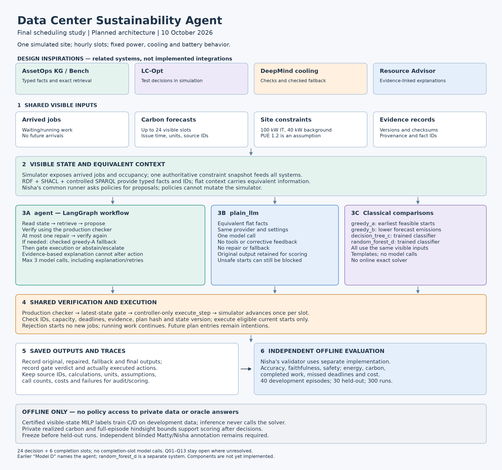

Teammates and roles

- Edison Perez Cash: energy and carbon calculations, greedy scheduling references, and trained decision-tree and random-forest policies (E2).
- Matty Anderson and Nisha Mahadev Kolekar: the LangGraph agent and plain-LLM comparison, verification and safety, evidence-based explanations, integration, evaluation and reporting (E4-E6).
- Reimo Tamme: source data, synthetic jobs, scenario splits and the simulator, working with Ved on E1 and E3.
- Ved Patil: shared contracts, ontology and retrieval, offline reference schedules and reproduction, working with Reimo on E1 and E3.

All teammates contribute their technical sections, interface coordination and results. Matty and Nisha share the research responsibilities listed above; their detailed implementation duties are divided in the [responsibility checklist](docs/team/03_RESPONSIBILITY_CHECKLIST.md). The package's detailed lead allocations remain recorded under Q12.

# Data Center Sustainability Agent

FSE 598, Arizona State University.

Nisha reports Group 15 presents in class November 16, 2026, submits the presentation November 18 at 11:59 pm, demos December 2 (submission 11:59 pm), and submits the report December 9 at 11:59 pm. Timezone, rubrics/formats and separate code/release requirements remain unconfirmed. See [the plan](docs/PROJECT_PLAN.md) and [attributed course record](docs/decisions/Q13_PRESENTATION_DEADLINE.md).

Our research question: Does an ontology-grounded, tool-verified agent improve the accuracy, faithfulness and safety of data-center sustainability recommendations compared with a plain LLM?

For human faithfulness annotations, two reviewers first retain independent original ratings. Nisha is the sole accountable owner for the inter-rater reliability report requested by the professor. Before adjudication, the report must show the matched assertion count, label counts or confusion matrix, raw percent agreement and Cohen's kappa, including a plain-language explanation when label imbalance makes kappa low or undefined. Extraction agreement, adjudicated scores and excluded no-ops/unmatched assertions are reported separately. [The recorded requirement](docs/decisions/PROFESSOR_FEEDBACK_IRR.md) does not permit either original to be rewritten.

We test this question through workload scheduling at one simulated data center. The main comparison is `agent` versus `plain_llm`, using equivalent visible information. The four additional scheduling policies provide reference results. Scheduling is the experimental setting; conclusions will be limited to the evaluated scenarios.

This repository contains implemented F02 records, data/simulator/retrieval/impact tooling, plain/evaluator preparation and the production checker, controller and bounded agent core. Greedy A and B are delivered with real checked-fallback receiving through PRs #75 and #81. PR #77 adds a probability-driven constructor for future C/D model outputs, but no trained C/D artifact or scientific result. Reviewed prompts, accepted live runtime evidence, runner integration and a separately authorized model-driven episode remain required. Training, the experiment CLI, held-out results and final demonstration are unfinished. [P02 B receiving](docs/handoffs/P02B_MATTY_RECEIVING.md) and [P03 constructor receiving](docs/handoffs/P03A_MATTY_RECEIVING.md) state the limits.

Current workflow update, October 24: [Matty's announcement](https://github.com/ReymoT/data-center-agentic/issues/57) and the coder-owned rule introduced in [instruction 1.27](docs/decisions/Q11_CODER_OWNED_DECISIONS.md) make the coder responsible for internal implementation choices. Shared changes need only directly affected owners; unresolved shared questions escalate within 24 elapsed hours. Ready coding continues while disputed behavior waits. The rule remains in force under instruction 1.28; the implementation/research status and existing scientific gates are unchanged.

[The current-plan audit](docs/handoffs/CODER_PLAN_AUDIT_2026-10-24.md) corrects stale pending-input/readiness text and links the separate P02, source and scoring issues. The coder-owned decision rule first published in 1.25 remains unchanged in 1.27. Reimo delivered the source inventory early through PR #65; final source/scientific acceptance is still open.

Latest October 25 update: [PR #75 receiving](docs/handoffs/P02A_MATTY_RECEIVING.md) corrects background IT capacity and tests actual A03/A04 execution, 30-slot replanning and agent fallback. [PR #81](docs/handoffs/P02B_MATTY_RECEIVING.md) adds B's fresh-forecast ranking and whole-decision checked-A fallback. [PR #77](docs/handoffs/P03A_MATTY_RECEIVING.md) adds an injected-probability constructor for future C/D training outputs. Current main CI passes 1,310 tests and 19 subtests. These are real component and receiving results, not a complete six-system study. Q07 training details and Q08 reference certification remain open.

A01 update: after the verified metadata-order fix, the actual approved plain request ran on CPU and reached its 120-second deadline. One uncertain attempt is spent; no response/API token counts were returned, the Plan request was not sent, and there was no retry. A later metadata-only check sent zero model requests and found a concrete host path: the accepted 0.40.5 runtime retained Matty's Arc 140V as Vulkan compute when integrated-GPU use was enabled. No model was loaded, so offload, context fit, latency and native counts remain unproved. Nisha/Ved agreement on this run-environment setting and a new bounded authorization are required before inference. [Host candidate and limits](docs/handoffs/A01_IGPU_HOST_CANDIDATE_2026-10-25.md).

## Systems we reviewed and why we chose this architecture

We reviewed AssetOps Knowledge Graph and AssetOpsBench, LC-Opt, Google DeepMind's data-center cooling system, and Schneider Electric's Resource Advisor Copilot. Our supplied system review compared their data, asset relationships, division of work between an LLM and deterministic software, testing, uncertainty, safety and approval controls.

AssetOps is similar to our project because it connects facts and dependencies through a typed knowledge graph. We use that idea for jobs, slots, constraints and evidence IDs. LC-Opt is similar because it tests decisions in simulation; our final scope uses a small Python scheduling simulator rather than its cooling digital twin. DeepMind is similar because checks and fallback protect execution; we use deterministic schedule checks, a latest-state recheck, checked fallback and abstention. Resource Advisor is similar because it explains sustainability information; we require source-linked claims, units, assumptions and limitations.

We chose a combination of these ideas because our question requires connected evidence, exact calculations, bounded model decisions and comparable saved outputs. RDF represents domain facts. LangGraph manages the agent's sequence of steps. Python checks decide whether a simulated action can execute. This is our best-fit design rationale, not proof that it is the best architecture or will outperform the alternatives. The experiments will test the complete agent; they cannot isolate the ontology's contribution. We have not reproduced these external systems or compared their accuracy directly.

The [source review record](docs/SOURCE_REVIEW.md) identifies the supplied documents and their public references. The [updated architecture diagram](architecture/architecture.svg) and [plain-language architecture document](docs/ARCHITECTURE.md) describe the final scheduling study. The diagram shows the target design; its status note identifies implemented components and remaining acceptance limits.



## Main comparison and scheduling references

The main research comparison uses two systems with the same arrived jobs, visible forecasts and authoritative constraints:

- `agent`: the ontology-grounded LangGraph agent, with one repair and checked greedy-A fallback.
- `plain_llm`: one model call with equivalent flat facts; no tools, repair or fallback.

Four additional policies use the same visible inputs to put scheduling performance in context:

- `greedy_a`: start jobs as soon as feasible.
- `greedy_b`: choose feasible starts with the lowest forecast emissions.
- `decision_tree_c`: a trained scheduling classifier.
- `random_forest_d`: a trained scheduling classifier.

These six systems do not represent six separate research questions. The study evaluates the complete agent against the plain LLM; it does not separately prove the benefit of ontology grounding or tool verification alone.

The earlier name "Model D" means the agent. Policy `random_forest_d` is a different system. Both learned policies are required; greedy policies and offline optimization are not substitutes for classical ML.

The site has 100 kW IT capacity including 40 kW background, constant job power of 10-40 kW and durations of 1-4 hourly slots. Jobs cannot pause once started. PUE 1.2 is a design assumption, with 1.0 used in hand checks. Episodes have 24 decision slots and six completion slots. No model calls occur in completion slots. The recorded Q01 direction permits new starts only in slots0-23; remaining boundary/consumer acceptance is still open.

Energy equals PUE times IT kW times hours. Emissions equal kWh times carbon g/kWh divided by 1,000, with the source's CO2 versus CO2e meaning still to be verified. Timing changes emissions, not the energy required for the same completed fixed-power work. Results must also show completed work, deadline misses and unfinished jobs.

Live equipment control, cooling or water savings, reinforcement learning, Modelica/FMU and enterprise integrations are outside the required project. No LLM fine-tuning is planned.

## Start with the instructions

Read [PROJECT_MASTER.md](PROJECT_MASTER.md), [shared rules](docs/team/01_SHARED_RULES.md), your `MASTER_<NAME>.md` in [the complete package](docs/team/00_START_HERE.md), [interfaces](docs/INTERFACES.md), [open decisions](docs/team/04_OPEN_DECISIONS.md), your assigned Issue and upstream handoffs. Ved's contract 1.0.0 schemas and examples are implemented. The interface document distinguishes those records from planned callable APIs; each consumer must still validate adoption. Experiment CLI names are not runnable commands yet.

See [the current maintenance handoff](docs/handoffs/F03_F04_F05_MAINTENANCE.md) for checks and remaining inputs, and [the publication audit](docs/team/REVIEW_RECORD.md) for current documentation status. The [original setup handoff](docs/handoffs/F01.md) is historical. These documents are published under the project manager's instruction; formal document review is not required.

## Quick start for the repository foundation

The package proposes Python 3.12. Windows is the only supplied dependency-lock target; additional supported operating systems await Q13.

```powershell
git clone https://github.com/ReymoT/data-center-agentic.git
cd data-center-agentic
git switch main
py -3.12 -m venv .venv
.venv\Scripts\python.exe scripts/validate_setup.py
```

The setup validator needs only the Python standard library and makes no network or model calls. It validates documentation links, task ownership/dependencies, role consistency, configuration placeholders and dependency input locations.

To validate the proposed full Windows environment:

```powershell
.venv\Scripts\python.exe -m pip install --require-hashes -r requirements/requirements-windows-py312.lock.txt
.venv\Scripts\python.exe -m pip check
.venv\Scripts\python.exe scripts/smoke_dependencies.py
.venv\Scripts\python.exe -m pytest tests -q
.venv\Scripts\python.exe -m ruff check dc_sustainability scripts tests
.venv\Scripts\python.exe -m ruff format --check dc_sustainability scripts tests
.venv\Scripts\python.exe -m compileall -q dc_sustainability scripts tests
```

Installation needs package-index access. Smoke checks run imports, SHACL/SPARQL, a tiny MILP, classifier fit/save/load and a LangGraph route without an LLM. See [environment instructions](requirements/README.md) for status and troubleshooting. The supplied lock is a candidate, not a final provider-inclusive environment. Do not use its Windows wheel hashes on other platforms.

The offline test command runs F02 contracts, D01/D06 inspection, D02 calibration tooling, D03 provisional scenarios, S01 transitions, L01 preparation, provider helpers, actual Ollama transport against a local synthetic HTTP test server, and actual fixed schedule checks. [New A03 consumer tests](tests/verification/test_d03_consumer.py) exercise D03-generated development jobs against those fixed checks without issuing approvals. Synthetic fixtures and server responses are test-only; they do not establish model inference, source acceptance or end-to-end integration. CI runs the same whole test directory on PRs and main. [The A01/A03 handoff](docs/handoffs/A01_A03_AGREED_CORE.md) links implementation and verification evidence.

All provider/account/settings placeholders in `.env.example` are blank. Keep them blank until the complete Q09 deployment configuration is recorded; the accepted development direction below does not fill missing pins. [The configuration template](configs/project.example.json) records known proposal constants and keeps decision entries null. It is not a production loader or an execution permission.

Matty accepted local Ollama with Qwen3 8B and temperature 0.2. [The Q09 decision](docs/decisions/Q09_OLLAMA_QWEN3.md) records the accepted development settings and owners: Matty prepares the shared adapter/environment, Nisha prepares plain/explanations, and Ved supports F02 compatibility. Matty supplied his [Intel Arc 140V / 32 GB hardware details](docs/HARDWARE.md); Qwen3 8B Q4_K_M is installed with [verified digest/license and reproducible setup](docs/OLLAMA_SETUP.md). The [October 20 Q09 record](docs/decisions/Q09_DEPLOYMENT_OCT20.md) accepts runtime 0.40.5, the full model digest, seeds 101/102/103, output projections and bounded probe rules. One accepted-runtime CPU request later timed out. The metadata-only Arc/Vulkan candidate keeps the accepted runtime and sends no model request, but it is not adopted live-run evidence. Validated counts/context/resources, affected-owner agreement on integrated-GPU use and new bounded run authorization still block another call.

## Installed local model

Qwen3 8B Q4_K_M is installed outside Git. The [latest desktop metadata](docs/evidence/ollama-qwen3-8b-2026-10-25.json) observes Ollama 0.40.11; accepted runtime 0.40.5 remains pinned. A separate [metadata-only accepted-runtime host check](docs/evidence/a01-igpu-host-2026-10-25.json) detects the Arc 140V through Vulkan with integrated-GPU use enabled. It loaded no model and sent no request, so it is host-discovery evidence rather than successful inference or measured offload.

```powershell
.venv\Scripts\python.exe scripts/inspect_ollama.py --compare docs/evidence/ollama-qwen3-8b-2026-10-25.json
```

## Available adapter and checker core

[The shared Ollama transport](dc_sustainability/llm/provider.py) performs real HTTP, strict F02 parsing, pin checks, deadlines and attempt accounting. It uses the Python standard library without choosing an SDK. Both LLM callers must share one run ledger. Q09 records development output projections, pins and limits; native counter equivalence and a successful matched run are still required. The Arc/Vulkan candidate is not a runnable experiment configuration or automatic model installation.

[The A01 accounting fix](docs/handoffs/A01_ERROR_ACCOUNTING_AND_FOLLOWUPS.md) retains excessively nested JSON failures as spent attempts, including their raw responses. These errors cannot escape the run ledger or allow a new slot to bypass its call cap. The same handoff links the earlier Q10-Q13 proposals; use the October 20 decision records for their current partial agreements and remaining gates.

[The production checker](dc_sustainability/verification/checker.py) now checks exact waiting-job coverage, valid deferral, individual abstention, Q01 start limits, evidence, timing and authoritative capacity. Complete valid plans can physically pass. Carbon claims, reference certification and execution remain separate. [The real controller and trace store](docs/handoffs/A04_CONTROLLER_TRACES.md) recheck current state before execution and preserve duplicate/refusal evidence. [The bounded agent](docs/handoffs/A02_BOUNDED_AGENT.md) uses these real components with explicit reviewed prompt/P02 inputs; missing inputs stay unavailable.

Run these components' offline tests with:

```powershell
.venv\Scripts\python.exe -m pytest tests/llm/test_ollama_provider.py tests/verification/test_checker.py -q
```

## Available plain-LLM preparation and simulator

Nisha's [plain comparator](dc_sustainability/llm/plain.py) and Matty's strict context-boundary fix are merged through PR #14. For a required nonempty-queue decision it uses one shared-adapter request, keeps the original response and performs no repair or fallback. [PR #30](https://github.com/ReymoT/data-center-agentic/pull/30) adds a deterministic empty-queue proposal with zero provider requests/attempts and no explanation. It leaves execution and clock progression to the actual controller through the receiving runner. Full runner adoption remains pending. The [assessment](docs/handoffs/L01_MATTY_ASSESSMENT.md) is historical candidate evidence; the fix is now on main. Full L01 still needs agreed context/deployment inputs and an actual development episode.

Reimo's [S01 simulator](dc_sustainability/simulator/core.py) reveals arrived jobs, applies typed current actions, records occupancy/completions/misses and advances on rejection. Agreed Q01 forbids new starts after 23. [PR #64](https://github.com/ReymoT/data-center-agentic/pull/64) is merged and implements removal of `allow_completion_starts=True` plus the agreed one-decision impossible-arrival visibility. Nisha's independent replay now uses the explicit Option B protocol. Ved's independent reproduction remains pending; merged code and green CI do not replace that scientific evidence. [Receiving tests](tests/verification/test_s01_checker_intake.py) exercise the actual checker/state boundary without bypassing the controller.

```powershell
.venv\Scripts\python.exe -m pytest tests/llm/test_plain.py tests/llm/test_plain_context_boundary.py tests/verification/test_s01_checker_intake.py -q
```

[The October 20 handoff](docs/handoffs/OCT20_SIX_PRIORITIES.md) records the latest agreements, follow-ups and nine A03/E01 hand cases. Nisha's E01 preparation is available through [PR #23](https://github.com/ReymoT/data-center-agentic/pull/23), with [Matty's review and boundary fixes](docs/handoffs/E01_MERGE_REVIEW.md). It independently checks one supplied decision and numerical claims. Structural episode replay is now merged through [PR #28](https://github.com/ReymoT/data-center-agentic/pull/28), with input/metadata comparison fixes and explicit unsupported completed-work handling. Full protocol/reference mapping and actual saved-output evaluation remain open in issue #24. The previously reported capacity-slack discrepancy is fixed; historical f5a2542 evidence remains unchanged. [Offline probe preparation](scripts/prepare_q09_probe.py) renders public development inputs and reports blocked gates; it never calls a model. The October 18 handoff is historical. Configuration examples remain blank.

## Data, experiments and outputs

Reimo implemented pinned SustainDC Arizona source acquisition, checksum/CSV inspection and private UTC observations. Ved's D06 checker/handoff is now merged. [Matty's version-matched Windows verification](docs/handoffs/D06_F04_F05_VERIFICATION.md) reproduced the pinned checksums, 8,760 valid timestamps and a 24-hour UTC window with identical adapter values. This is structural evidence; pollutant meaning, physical interval mapping, dataset rights, factor alignment and F02 adoption still block accepted experimental use. [Data instructions](data/README.md) record acquisition and evidence. D02 implements explicit-field/unit calibration tooling, but actual Frontier access and empirical statistics are still blocked. D03 implements provisional synthetic jobs across four scenarios and private episode assembly; it is not Frontier-calibrated or the frozen development/held-out dataset. Q05/Q06 and downstream adoption remain open. EPA eGRID is an annual plausibility check. Perfect-foresight forecast replay must be labeled and must not be confused with a live forecast.

The implemented source-inspection command is:

```powershell
.venv\Scripts\python.exe -m dc_sustainability.data.carbon_source --help
```

Its help describes local inspection and the optional pinned download. A download uses the network and requires new destination/report files. Validation success is not scientific acceptance; returned records are not adopted F02 forecasts. Offline CI does not download the source.

Use [D02 calibration instructions](data/D02_CALIBRATION.md) for its implemented Python API and source blockers, and [D03 instructions](data/D03_SYNTHETIC_SCENARIOS.md) for the provisional generator. The following implemented command writes a new synthetic development job catalog; use a new filename if it already exists. This test seed is not an accepted experiment seed.

```powershell
New-Item -ItemType Directory -Force data/private | Out-Null
.venv\Scripts\python.exe -m dc_sustainability.data.scenarios data/private/d03-local-jobs.json --seed 42 --split development
.venv\Scripts\python.exe -m pytest tests/verification/test_d03_consumer.py -q
```

The local catalog is ignored by Git. It contains private job metadata and future arrivals: do not pass it wholesale to a policy. Windows CRLF and Git's LF bytes produce different file hashes despite matching JSON content; [the current handoff](docs/handoffs/A03_D03_F04_F05.md) records the observed hashes. The A03 test-only arrived-job projection is separate from the now-implemented S01 simulator; it does not establish full integration.

The proposal requires 40 development episodes and 30 held-out episodes: six dates across four scenarios plus six missing-forecast episodes. Three trials for each LLM and one for each A/B/C/D policy produce 300 runs. Held-out data cannot tune models, prompts or thresholds. The agent has at most three model calls per decision including explanation; the plain LLM has one. Paid runs await Q09.

Nisha will define the CLI during F02/E02 implementation with the module owners. Data validation, graph validation, labels, training, single-episode runs, matrix runs, scoring and figures are planned commands, not runnable commands in this scaffold. The [demo runbook](docs/DEMO.md) records the future evidence requirements without inventing a transcript.

`data/` will hold permitted fixtures and manifests, `ontology/` graph definitions, `models/` trained-artifact manifests, and `results/` trace/evaluation manifests. Raw/private data, generated runs, secrets and large artifacts are excluded from Git by default. License and retention decisions await Q05/Q13. No license is selected here.

## Workflow and remaining work

The masters and shared instructions on GitHub's `main` branch are authoritative. Only Matty Anderson (`MattyAnd`) may authorize changing them. Teammates and their AI assistants must not overwrite, replace or publish new versions without his explicit authorization. Propose corrections in an Issue. Local copies and higher version numbers do not supersede main; preserve unpublished code when synchronizing instructions. This project rule is documented in [PROJECT_MASTER.md](PROJECT_MASTER.md); GitHub-enforced access restrictions require repository-owner action.

A pull request can be merged once its checks pass. A teammate review is welcome but not required. Changes to shared data formats or settings still need the affected teammates to agree first.

Record affected teammates' agreement in the Issue or decision record before changing shared formats or settings. Matty is the project manager and has also authorized direct publication of these documents to `main`. Development can use short task branches, with applicable checks before publication. [Module ownership](docs/OWNERSHIP.md) supports technical coordination, and [repository settings](docs/REPOSITORY_SETTINGS.md) record the current workflow. Matty's GitHub account for this project is [MattyAnd](https://github.com/MattyAnd).

The [project plan](docs/PROJECT_PLAN.md) links the authoritative checklist and timeline. The [decision register](docs/team/04_OPEN_DECISIONS.md) retains unresolved choices and records partial Q09/Q11 decisions. Shared-record consumer adoption, source evidence, final provider/budget pins, remaining team permissions, detailed allocations and target platforms still need evidence. Stubs, constant success verdicts and fabricated model responses/traces/results are not completion evidence. Final end-to-end acceptance belongs to Matty, independent verification to Nisha, and second-machine reproduction to Ved.
