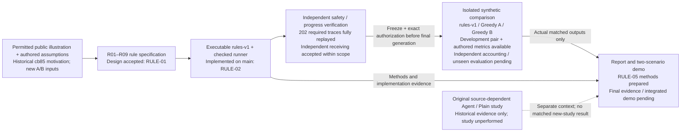
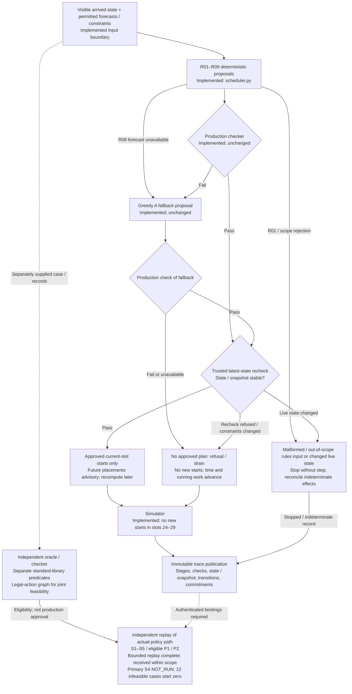

# RULE-05 editable workflow figures

Reimo Tamme; November 23, 2026. Evidence baseline: main
`91e23b6f85c6240ec22d2a23e14f1eaf924427c4`, instruction 1.30.
[Methods and source evidence](RULE05_FOCUSED_STUDY_METHODS.md) govern both captions.
These Mermaid sources can be reused in the report and #246 demo. Status is written
in each node so grayscale reproduction does not depend on color. Neither figure
is a measured result. Export/layout in the final report remains the assembly owner's work.

## Figure 1. Research workflow

Caption: rules are hand-authored, not learned. The November 20 acceptance freezes
the specification design. Implementation and independent harnesses are available;
required bounded verification is complete and independently received within scope;
unseen synthetic findings remain pending. Original INCOMPLETE and host FAIL records
remain preserved. Primary S4 is NOT_RUN; all policies start zero jobs in the 12
infeasible primary cases. Optional extended coverage was not run.
The historical study is separate. Arrows describe dependencies, not completed gates.
RULE-04 generation/execution also requires the exact #244 freeze, receiving,
containment and fresh bounded authorization. No such run is authorized by this figure.

## Figure 2. Scheduling, execution and separate verification

Caption: the production checker gates execution and is not Nisha's independent
oracle. The runner implements the trusted control path; approval applies only to
current starts. Selected empty plans can pass as no-ops. Failed approval drains;
out-of-scope rules input or changed live state instead stops without stepping.
Records/hashes detect changes but do not authenticate their own source. The
independent path establishes no execution permission. Safe refusal is not P1
success when it prevents completion of eligible feasible work. Main's historical
176361a archive is received evidence, not verification of corrected main.

The diagrams reflect merged main through PRs #270/#271. The accepted
[RULE-03 section](RULE03_VERIFICATION_SECTION.md) controls verification counts and
limits; the [RULE-04 review](../handoffs/RULE04_DEVELOPMENT_HANDOFF_REVIEW_NOV23.md)
controls partial authored metric claims. PRs #260/#261 are merged; demo wiring is
available in the [RULE-07 handoff](../handoffs/RULE07_EXECUTABLE_DEMO.md).
See the [RULE-05 demo handoff](../handoffs/RULE05_DEMO_HANDOFF.md) for scenario
interpretations. Diagrams do not establish unseen evaluation or accounting acceptance.
