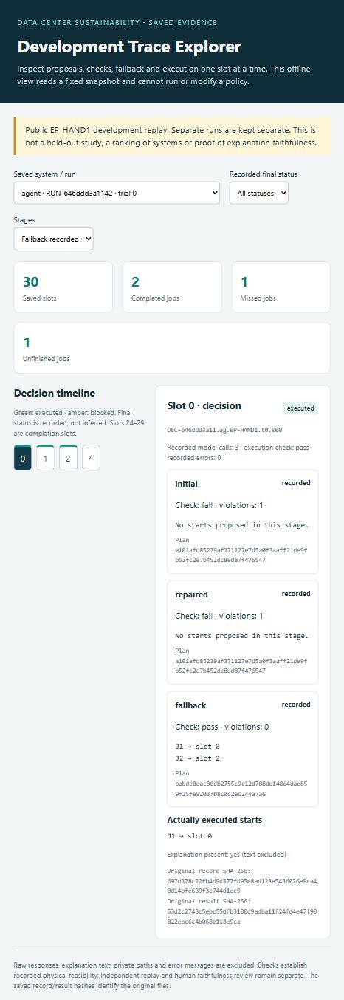

# Read-only saved-trace explorer — section H draft

Owner: Matty, under the authorized demo and R04/R06 work. This implements the
UI/visualization section requested in the reported final-report rubric. It does
not imply that the four rubric points have been awarded or that I04 is complete.

The explorer is a standalone offline HTML projection of complete saved public
EP-HAND1 units. It displays the original system/run identity, saved job outcomes,
slot timeline, initial/repair/fallback plans and their actual recorded checks,
execution checks, actual starts, request counts and original record/result hashes.
Filters select a unit, final status or recorded repair/fallback stage. Missing
checks say "not checked"; absent stages distinguish not applicable from not
performed. Completion slots and valid no-op execution are not job starts.

The exporter validates F02 records, consistent result/trace identities, hash-based
filenames and one trace per slot 0–29. It refuses other episode IDs and duplicate
units and writes a new output file without modifying inputs. Only an explicit
field allowlist is exported. Raw responses, explanation text, original error
messages, private paths, inputs and human rating files are excluded. CSP disables
network requests; there is no run, upload or operating-control action.

## Actual development demonstration

The manager-local snapshot `Trace_Explorer_2026-11-02/trace-explorer.html` contains
six original saved units / 180 traces from the two previously indexed runs. It
was built without rerunning a policy or making a model request. The snapshot hash
is `1677a89bf53d6dfc6ec174eeda97a6d84ef9b83cbecef5fe170093ed5770dc37`.
Separate runs remain separate; the view supplies no statistical comparison or
held-out findings. An actual browser check verified Agent fallback filtering,
empty filters and slot-24 completion display. The screenshot below is that
development evidence, not a mock UI or a live model run.



## Reproduce locally

From the repository root, substitute the explicit saved unit directories and a
new output filename. No network/server is required to open the generated file.

```powershell
python scripts/build_trace_explorer.py --unit-dir C:\private\saved-run\units\unit-key --out C:\private\trace-explorer.html
```

Repeat `--unit-dir` for additional saved public units. These example paths are
placeholders, not claims of provisioned storage. Generated snapshots remain local
until their contents and sharing destination are reviewed. No hosted site was
published. Original execution replay and human faithfulness ratings remain
independent; the explorer only presents recorded fields.
