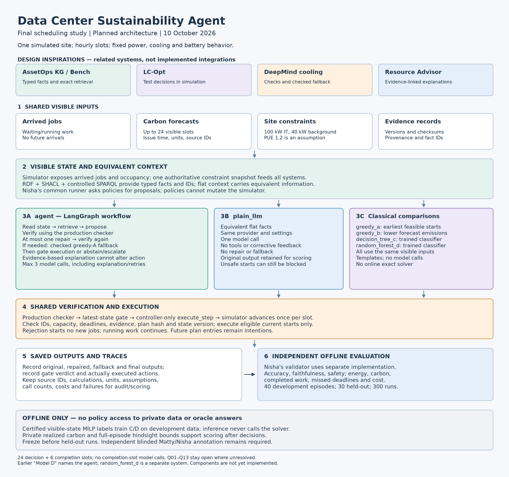
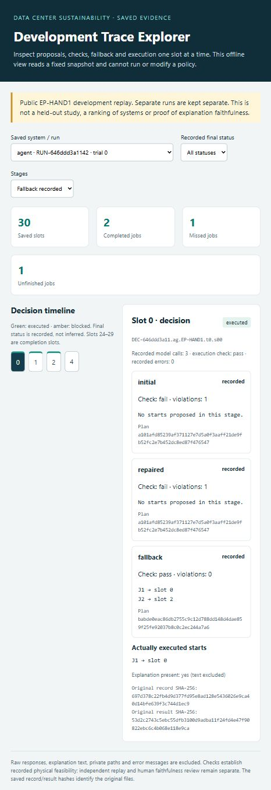

# Explicit Rules for Safe Simulated Scheduling — Working Report

November 19 active plan: [the focused rule-system study](../decisions/NOV19_RULE_STUDY_PLAN.md) supersedes the November 18 evidence-only baseline as our primary delivery. Missing source permissions/provenance/verified inputs prevented the original held-out study; Professor Hasan recommended lifting explicit rules from representative permitted examples, lowering them into an executable discrete scheduler and independently verifying safety and progress. We will demonstrate two scenarios and, after frozen-protocol authorization, test on new independently authored synthetic cases against compatible Greedy A/B references. Core work is due November 25, fixes/reproduction November 26-27 and audited candidate November 28. Start now; these are deadlines, not start dates. The evidence-only package remains backup. The original research question is unanswered; no new results, source approval or model runs are claimed. Earlier dated status entries below are historical where superseded.

Group 15, Project 21. Working assembly, November 19, 2026 (America/Phoenix).
Members: Edison Perez Cash; Matty Anderson and Nisha Mahadev Kolekar; Reimo Tamme;
Ved Patil. R05 assembler: Nisha. R04/R06 preparation: Matty.

This is the working report for the focused rule-system study, not the final IEEE PDF. The November18 development-evidence-only path is retained as backup, not the primary research scope. Existing implementation and measured development observations remain historical evidence. New rules-v1 code, independent verification and synthetic evaluation results are not claimed complete. Original owner drafts, ratings and source limitations remain preserved. Evidence keys refer to the [index](VERIFIED_EVIDENCE_INDEX.md); final layout, citations, attribution, release checks and submission remain unfinished. [E11,E12]

## Abstract — working text

We ask whether a compact set of explicit rules can reproduce safe, explainable scheduling decisions and generalize to unseen synthetic scenarios. The focused study design lifts rules from permitted illustrative examples and declared assumptions, lowers them into a deterministic discrete scheduler, and independently checks safety and progress within explicit finite bounds. Two authored scenarios cover carbon-aware timing and overloaded or infeasible workloads; failed proposals, attempted fallback and actual execution are kept distinct. The proposed evaluation compares the rule scheduler with Greedy A/B on separately generated synthetic cases after protocol freeze. At this drafting checkpoint, the rule specification and adapter proposal are prepared, while consumer acceptance, implementation, bounded verification and new evaluation are pending. Earlier Agent/Plain infrastructure and public technical validations supply historical implementation evidence, not results for this new question. The original source-dependent held-out study was not performed. We therefore make no claim of rule-system generalization, universal safety, human faithfulness, real-site carbon savings or Agent superiority. This draft distinguishes completed evidence from planned methods and unresolved limits. [E1-E12]

## 1. Introduction

The current question is: can explicit rules reproduce safe, explainable scheduling decisions and generalize to unseen synthetic scenarios? The rule table, deterministic joint-selection objective, study-local trace identity and independent verification boundaries are specified prospectively. Verification separates safety from progress under joint-feasibility and closed-workload assumptions. Any newly generated evaluation cases must remain separate from rule development; failures and missing comparisons will be reported rather than filled with favorable values. [E12]

The legacy setting and infrastructure discussed in sections2-9 below remain historical technical context unless explicitly labeled as the new focused-study design. Their six-system measurements, three-fold model metrics and human annotations must not be pooled with the new three-policy synthetic comparison. The new proposed toy cases use60kW capacity/20kW background/PUE1; the smaller verification domain uses30/10/PUE1. These authored assumptions differ from the historical100/40/PUE1.2 setting. [E1-E12]

Flexible jobs can execute at different times. Under fixed job power and site PUE,
moving the same completed work between slots changes modeled emissions when the
carbon-intensity inputs differ, without changing that work's energy. A fluent
recommendation can nevertheless overload capacity, miss a deadline or assert a
saving that its evidence cannot support. The relevant question is recommendation
quality, not whether text sounds plausible. [E1, E2]

Our original, still unanswered research question is: does an ontology-grounded, tool-verified agent improve
the accuracy, faithfulness and safety of data-center sustainability
recommendations compared with a plain LLM? Scheduling supplies bounded decisions
that can be checked and independently replayed. Agent and Plain use the same
underlying model and equivalent visible information. Two greedy policies and
decision-tree/random-forest references provide additional scheduling context;
they are not additional research questions. [E1, E2]

The original proposed comparison targeted the combined grounding/checking/repair workflow. It does
not isolate the causal contribution of each component, and Agent has a larger
bounded call budget. Development integration, human rubric calibration and a
frozen held-out study are different evidence categories. The first two have
retained records; final study conclusions remain pending. [E2, E4-E7]

## 2. Problem and simulation setting

The simulator represents one site with 100 kW IT capacity, including 40 kW
background load, one-hour slots and assumed PUE 1.2. Synthetic jobs have arrivals,
durations, constant power and deadlines. Jobs cannot pause after starting, and
nonflexible jobs must start at arrival. These assumptions are not calibrated
measurements of a real facility. Episodes have 24 decision slots and six completion
slots. New starts belong only to the decision window; completion slots drain
running work. Scenarios cover normal operation, limited flexibility, an arrival
spike and an intentionally impossible job; a further variant withholds forecasts.
Policy views exclude future arrivals and private realized-carbon values. [E1, E2]

A plan classifies waiting jobs into starts, deferrals or abstentions. Proposed
future starts are recommendations; only eligible current-slot starts may execute
after latest-state verification. Feasibility depends on arrivals, deadlines,
nonflexibility, capacity across occupied slots and the start window. Missing
evidence and verified infeasibility must remain distinguishable. [E1, E2]

For energy in kWh and intensity in g/kWh, modeled kilograms are energy times
intensity divided by 1000. Energy uses PUE times IT power times slot duration.
The equal-work comparison refuses savings when completed or unfinished work,
inputs or other required conditions differ. Blocked/undefined savings are not
zero savings. Source pollutant basis, physical interval interpretation and site
applicability remain unresolved, so these are bounded proxy calculations rather
than verified real-site CO2e or avoided-emissions estimates. [E2, E8]

## 3. Related work and architecture rationale

Our scoped source review considered carbon-aware scheduling, grounded agents,
simulation and safety controls. Wiesner and Radovanovic motivate temporal
flexibility; Carbon Explorer examines broader carbon-aware design. SustainDC
provides a richer control setting than our single scheduling simulator. The
reviewed LC-Opt cooling benchmark motivates simulation before application, not
a cooling/digital-twin subsystem in this project. [Wiesner, Radovanovic,
CarbonExplorer, SustainDC, LC-Opt; E1]

ReAct and retrieval-augmented generation motivate grounded tool use and retrieved
context. AssetOpsBench is an industrial-agent benchmark; the separate typed-graph
work motivates the structured data layer. DeepMind's public cooling description
motivates constraint checks, fallback and oversight. Resource Advisor's public
description motivates conversational sustainability access, not an established
faithfulness score. These sources explain our design choices and similarities;
they do not prove our architecture is best or establish literature-wide novelty.
Descriptions and citation status reuse the existing scoped review, not a new
systematic literature audit. [ReAct, RAG, AssetOpsBench, KG-Assets, DeepMind,
ResourceAdvisor; E1]

## 4. System architecture and algorithms

### 4.1 Facts, ontology and retrieval

Versioned F02 records separate private episodes, policy-visible states,
constraints, forecasts, plans, checks and traces. RDF construction and controlled
queries provide the graph context; flat projection supports equivalent Plain
facts. Ontology/SHACL and unit-mapping helpers provide typed validation. Their
existence does not imply every source is accepted or that graph-derived text is
the authoritative execution contract. Production checks consume the authoritative
F02 inputs. Missing, stale or unsupported evidence is explicit. [E1, E2]

The corrected [R02 methods handoff](R02_ONTOLOGY_AND_REFERENCE_METHODS.md),
reconstructed in #235 after #234 merged an empty file, records controlled SPARQL,
equivalent canonical graph/flat content and offline ontology/unit/SHACL helpers.
Unit mapping adds semantic identifiers without converting values or establishing
pollutant basis. The visible reference uses binary job/start decisions with
exactly-one-start, timing/nonflexibility and per-slot occupancy constraints;
solver certification remains conditional on encoded inputs/backend settings.
Cached labels refer to one selected schedule, not all possible optima. Private
hindsight and policy-visible contexts remain distinct. These are methods and
development evidence, not completed O04 or I03. [E2, E6, E11]

### 4.2 Agent, Plain and controlled execution

The agent workflow uses LangGraph orchestration for grounding, proposing,
checking and routing. It can make one bounded repair and use a checked Greedy-A
fallback or abstain. The controller rechecks against the latest state before any
effect. Raw model proposals cannot mutate the simulator directly. Trace records
retain initial, repaired and fallback stages, checks, actual executed starts,
request accounting and outcome identity. Idempotency/trace reservation prevents
unrecorded automatic retry of an uncertain effect. [E1, E2]

Plain makes one model request at a required decision, without agent repair or
fallback; deterministic empty queues can be no-ops without a model request. Both
paths share the execution gate. Shared execution protection must therefore be
distinguished from unsafe proposals: a blocked proposal is not an executed
violation. [E2, E3]

The adopted prospective profile uses local Ollama/Qwen3 8B, temperature 0.2,
16384 context tokens, 4096 output tokens and a 12288 prompt ceiling, with explicit
explanation-field limits. Historical runs retain their original limits. Settings
adoption, actual per-run configuration and scientific freeze are separate records;
this draft does not promote defaults or authorize another request. [E3]

### 4.3 Classical and learned references

Greedy A proposes earliest feasible starts. Greedy B ranks forecast emissions
with checked fallback when required forecast evidence is unavailable. The learned
references produce candidate probabilities and use a deterministic
probability-to-schedule constructor through the common checks/controller. The
constructor prioritizes nonflexibility and latest-start urgency, then decreasing
probability, earlier start and numeric/full job ID, reserving at most one start
per job under cumulative occupancy. The 0.5 classification threshold is not a
schedule filter. Edison's accepted [R03 handoff](R03_CLASSICAL_POLICIES_AND_ML.md)
records impact, candidate/training, artifact and inference limits. Current
development artifacts are a depth-8 decision tree and a 100-tree, depth-10 random
forest. Their selection used development rollouts, not a post hoc choice of the
largest classification F1. [E1, E6]

Visible-state O02 references and offline hindsight are separate. Only certified
outcomes support definite labels; missing forecasts or unresolved solver outcomes
remain unavailable/excluded, not negative labels or fabricated infeasibility.
Alternative optimum multiplicity and final tie-break acceptance require their own
evidence. O04 held-out labels remain a later task after accepted I02 and frozen
inference. [E2, E6, E7]

## 5. Data and input preparation

The development allocation has 40 fixed episodes and three blocked folds of
16/12/12, with immutable public identity/content commitments. The pinned source
metadata describes an 8760-row historical 2022 AZPS intensity proxy in SustainDC.
Public receipts describe identity and transformations; they do not supply full
source lineage, CSV-specific physical interval meaning or applicable exact-use
evidence. B1-B3 remain unresolved and B4 provisional. Frontier job-trace empirical
calibration has not been established and is not described as an observed training
source. [E8]

The November 15 named-file check found all 40 Matty episode files and matched
their byte hashes to the public v2 receipt. That check did not parse episode
values or open the CSV. No original 1200-state history is thereby recovered.
The new bundle assembler is implemented and synthetic-tested: it preserves the
episodes and reproduces legacy persistence forecasts from an explicit permitted
340-row extract, without a CSV fallback or new simulator states. Actual permitted
extract/custody evidence and fresh operation approval remain missing. [E8, E9]

The legacy forecast projects a preceding-row value over the visible horizon.
Flat within-issue forecasts can produce objective ties; development feature/label
behavior cannot certify a changed forecast's consequences. CF60 comparison,
reference/model compatibility and study forecast adoption remain gated. Source
interval hypotheses are not silently selected or shifted to improve results.
[E6, E8, E9]

## 6. Evaluation design — prospective, not executed study results

The planned matrix has 24 core and six withheld-forecast episodes. A/B/C/D have
one trial each; Plain and Agent have three each, producing 300 planned units.
The same frozen episodes and visible information support matched comparisons.
The I02 checklist is currently 13 pending and five blocked, with zero frozen
items and no accepted freeze commit. Metadata-only custody receiving is not
held-out content materialization, source permission or a completed study. [E7]

The accepted November 12 handoff is metadata-only: Nisha reports six dates in
six months, 24 core plus six withheld records and 26 passing independent checks.
Matty accepted her authenticated public report without receiving the private
metadata/report or rerunning those checks. Operational custody, source-use
permission and actual episode contents remain separate pending gates. [E7, E8]

The merged study-packet builder presents each blinded output with its own
replay-verified visible state and matching immutable snapshot. It shows the final
recommended plan, which is not proof of execution; missing/mismatched hashes,
incomplete units and identity mismatches withhold a pair with a recorded reason.
The unblinding key remains separate. The table renderer formats saved study-table
JSON without recomputing results. These are implemented tools, not completed
held-out packets or findings. Matty reserved November 25 and 28-30 for up to 180
outputs plus adjudication; November 26-27 remain reserved. [E7]

Evaluation separates accuracy/completion/reference gaps, safety of proposals and
execution, abstention/fallback, resource accounting, and human explanation
faithfulness. E01 reconstructs execution separately from the production checker.
Human labels assess supported, contradicted and unsupported assertions; extraction
and completeness decisions are additional denominators. Matching and reliability
precede adjudication; both originals remain unchanged. [E2, E4, E7]

The prospective statistics include matched episode-level comparisons that retain
all LLM trials together, confidence intervals and a date-cluster sensitivity
analysis. Emissions comparisons require equal completed work. No source-derived
or forecast-only result is used as a substitute for feature, label, model or rollout
acceptance. The final analysis must retain unavailable counts and distinguish the
core and withheld-forecast cohorts. [E7, E8]

## 7. Verified development observations

### 7.1 One saved public technical validation

RUN-cb85f5a3425c on public EP-HAND1 produced six system results, 180 records and
17 model requests (five Plain, twelve Agent). Saved execution replay had zero
findings and zero result mismatches, and cleanup passed. All 39 generated claims
paired numeric values and allowed units; no explanation field reached the
256-character cap. The null/null branch was not natively sampled. These are
contract/recording observations, not a faithfulness or comparative effect score.
Nisha's separate-person scoped technical receiving was accepted. [E3, E4]

In that example, Agent executed J1 from checked fallback at slot 0 and J2 from an
initial model plan at slot 3. Both recorded repairs failed their checks. Plain
completed no jobs in this particular example. These outcomes must not be credited
to the model alone or converted to a general success rate. The fixture's shaped
forecast also differs from the legacy development persistence setting. [E3, E4]

Saved explanation assessment still records capacity, citation-applicability and
unsupported-rationale findings. Valid number/unit structure does not make the
number true or its citation relevant. Replayed physical consistency does not
resolve explanation faithfulness, trusted-UTC freshness or impact support.
Earlier failed validations are retained rather than replaced by this success.
[E3, E4]

### 7.2 Development human reliability

The development rubric round had 11 synthetic cases, 22 output units and 20
reviewed outputs after two empty-queue no-ops. On 32 matched claim assertions,
24 agreed: raw agreement 75.0%, Cohen's kappa 0.00. One rater used supported for
every claim, so expected agreement equals observed agreement. The confusion
matrix has four contradicted and four unsupported disagreements in the other
original. Raw agreement alone therefore overstates consistency. Summary/limitation
extraction has 64 one-sided assertions and zero matched assertions. [E5]

The separate joint adjudication resolved 77 items; it does not replace or
recompute pre-adjudication reliability. Later calibration and clarified extraction
rules are retained development protocol work. The sample is small and synthetic;
one rater authored the cases and had prior exposure. Held-out annotations and
their reliability repeat remain pending. No new human
judgments are assigned by assembling this draft. [E5, E7]

### 7.3 Existing C/D development classification metrics

| Existing selected model | Precision | Recall | F1 |
| --- | ---: | ---: | ---: |
| Decision tree, depth 8 | 0.394 | 0.578 | 0.469 |
| Random forest, 100 trees, depth 10 | 0.456 | 0.618 | 0.525 |

The published support is 1411 positive and 4635 negative definite rows. Scores
pool disjoint development validation folds after selection; they are descriptive
classification metrics, not scheduling outcomes, unbiased final estimates or a
research-endpoint improvement. Original excluded-candidate counts are unavailable
from the saved definite-row corpus. Existing selected binaries are unchanged;
an alternative configuration with higher F1 is not silently reselected. [E6]

### 7.4 Held-out findings — not performed

The held-out study was not performed in the activated evidence-only delivery. No final held-out accuracy, faithfulness, safety, emissions comparison,
O04/P07 output or held-out reliability value is reported. Do not insert zeros,
development values or claims that the hypothesis is positive here. [E7]

## 8. UI and saved-evidence visualization

The trace explorer is a read-only offline view of saved public EP-HAND1 records.
It exposes system/run identity, slot timeline, recorded plan/check stages,
fallback and actual executed starts, with original hashes. It cannot run a model,
change policy behavior, upload data or establish annotation truth. Raw responses,
explanation text, private inputs/paths and ratings are excluded from its exported
projection. [E10]

This existing screenshot belongs to the earlier documented saved-development
explorer snapshot, comprising two original runs. It is not a screenshot of
RUN-cb85f5a3425c, not a new live capture and not a held-out study. The later cb85
counts in section 7 remain tied to their own source records. Keep run identities
separate when choosing final figures. [E3, E10]

## 9. Contributions — attribution draft, not completion certification

| Member | Existing responsibilities and evidence | Confirmation still needed |
| --- | --- | --- |
| Edison Perez Cash | Classical/learned policies and impact; public model/development-metric records | R03 methods/contribution handoff received (#230); P07 and final acceptance pending |
| Matty Anderson and Nisha Mahadev Kolekar | Shared research comparison/evaluation; Matty adapter, graph workflow integration, checker/controller, CI and release preparation; Nisha Plain/explanation, independent evaluator and reliability/report assembly | Distinct detailed ownership retained; final R04/R05/R06 and held-out review remain pending |
| Reimo Tamme | Data/scenario/simulator development and source evidence records | R01 reconstructed by Matty; personal attestation not invented; source limits retained |
| Ved Patil | Contracts, graph/retrieval, reference methods and reproduction work | R02 methods reconstructed/received (#235); personal contribution attestation and O04/I03 pending |

Nisha's [repository contribution statement](NISHA_CONTRIBUTIONS.md) is received
through #229, alongside her introduction/problem, related-work and evaluation
handoffs. Edison supplied his methods and contribution in #230. Nisha's statement
covers Plain/explanation rendering, independent replay/evaluation, runner/matrix,
review/sampling/reliability tooling and report assembly; implementation ownership
is distinct from completed final study execution. Her metadata receiving remains
an attributed public report, not manager-rerun operational custody acceptance.
Ved's originally empty R02 file is now repaired through #235 and available for
assembly. Its evidence-based responsibility summary is not an invented personal
attestation. Matty reconstructed [R01 data/simulator methods](R01_MANAGER_RECONSTRUCTION_NOV18.md)
from retained implementation and evidence without waiting for another Reimo handoff.
This is not a personal contribution attestation. Reimo's November 18 source-status
reply is received; B1-B3 remain unresolved and B4 provisional. New source processing
is discontinued for the active delivery; its limitations remain explicit. [E11]

The responsibility checklist and owner drafts govern attribution. Matty's
contribution statement is available; this table does not invent personal
attestations from other owners or credit coordination as authorship of their code.
[E11]

Third-party libraries/runtime/weights include LangGraph, rdflib/pySHACL,
scikit-learn/joblib, Ollama and Qwen3. Exact versions/terms and source applicability
must be disclosed through the existing source/lock records. Project publication,
public receipts and software licenses do not establish blanket data/model
redistribution rights. Private source-derived data and binaries are not bundled
with this draft. [E1, E8, E11]

## 10. Working conclusion and next evidence

The active contribution is a focused rule-system study with explicit, prospective methods and independently checkable properties. Its implementation, bounded verification and isolated synthetic evaluation still need actual artifacts; the current evidence cannot answer the new research question yet. A rule explanation is not automatically a faithfulness judgment, and bounded synthetic verification is not a real-facility or arbitrary-scale guarantee. [E12]

Historical Agent/Plain infrastructure demonstrates selected development behavior, including failed repairs, fallback reliance and explanation limitations. It does not establish superiority over a plain LLM. The original held-out study remains unperformed and its question unanswered. Source B1-B3 remain unresolved and B4 provisional; #60 was closed NOT_PLANNED rather than certified resolved. [E2-E9]

Following Hasan's guidance and Matty's November19 decision, the primary plan is executable explicit rules, independent bounded verification and new synthetic tests against Greedy A/B where feasible. The November18 evidence-only package remains backup. No new test results, model runs, accepted source rights or scientific freeze are inferred from publishing this report update. Exact adapter/generator acceptance, code/specification hashes and fresh bounded execution authorization remain gates; final report layout, attribution, rights review and submission are separate. [E11,E12]

## Presentation-feedback follow-through — pending experiments

The professor feedback supplied by Matty requests grouped ten-fold training/tuning for C/D, explicit verifier arithmetic and repair deltas, an ML-ranked warm-start Agent variant, and a turnaround-versus-equal-work emissions-reduction plot. These follow-ups are tracked with owners and acceptance criteria in [the November 17 record](PROFESSOR_FEEDBACK_FOLLOWTHROUGH_NOV17.md). Grouping must also isolate shared source windows; ten folds do not automatically reduce estimator variance. Structured feedback and hybrid ranking would be versioned protocol changes, not descriptions of the current Agent. Turnaround means completion minus arrival, and reduction needs valid paired equal-work evidence relative to Greedy A. No new training, repair, hybrid or Pareto results exist from recording this request. Final report and demo must include the actual disposition of all four items, including explicit limitations where evidence remains unavailable.

Offline designs now specify [repair arithmetic/delta semantics](REPAIR_FEEDBACK_DESIGN_NOV17.md) and the [separate ML warm-start variant](ML_WARMSTART_DESIGN_NOV17.md). They are proposals with fixed boundary/verification criteria, not implemented feedback or hybrid results; exact shared agreement and later execution authorization remain required.

## References and assembly note

Use [REFERENCES.md](REFERENCES.md), preserving its verified/preprint/unconfirmed
metadata labels, then number citations by first use in the IEEE template. Keep
the original owner drafts for introduction/problem, related works and evaluation
as editable sources. This Markdown source is not a rendered 5-10-page IEEE PDF;
no layout, final review, upload or course acceptance is claimed. [E11]
